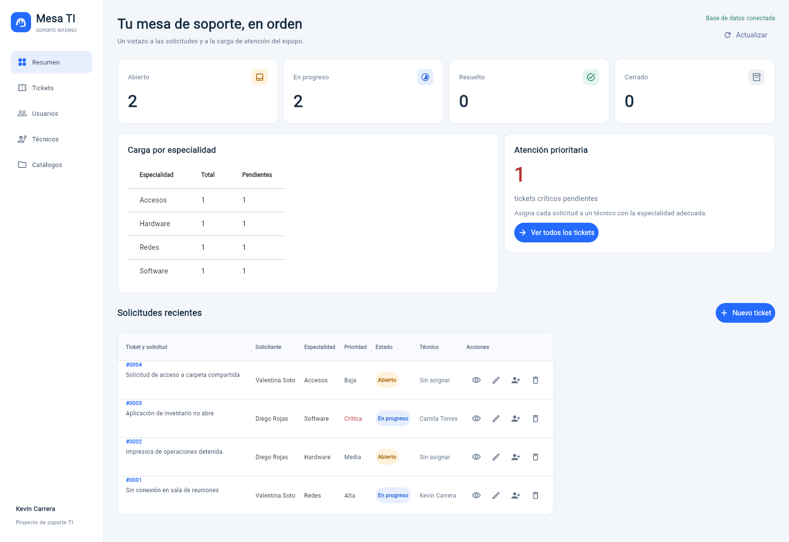
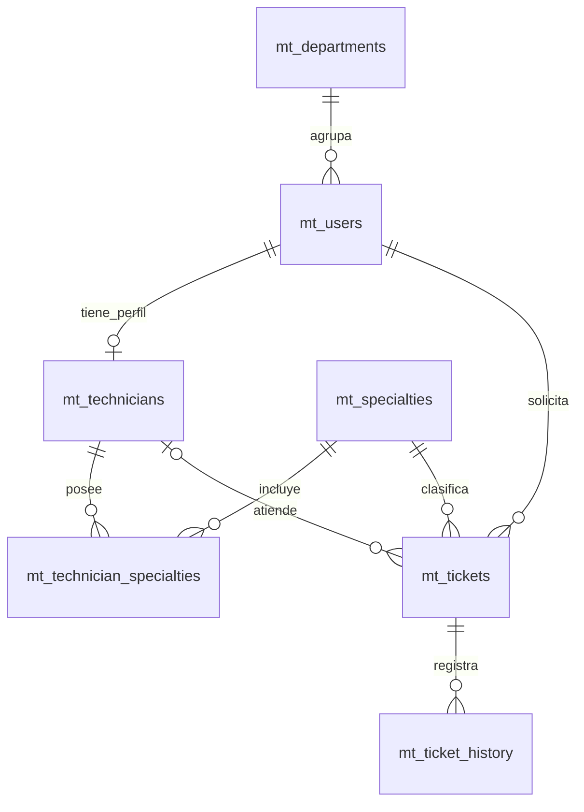

# Mesa TI

Sistema de tickets de soporte TI desarrollado por **Kevin Carrera** con Python, Flet y MySQL. Centraliza solicitudes internas para saber qué problemas están pendientes y quién los está atendiendo.



## Ejecutar

En este equipo el entorno y el archivo `.env` ya están configurados. Desde PowerShell:

```powershell
cd C:\Users\kevin\Downloads\Kikolas
.\.venv\Scripts\python.exe main.py
```

La aplicación abre [http://127.0.0.1:8550](http://127.0.0.1:8550). Mantén la terminal abierta; presiona **Ctrl + C** para detenerla. Si ya está funcionando una instancia, abre directamente esa dirección.

## Instalar en otro equipo

Requisitos: Python 3.10 o superior, una base MySQL 8.0.16 o superior ya creada y permisos para crear tablas y procedimientos.

```powershell
py -3 -m venv .venv
.\.venv\Scripts\python.exe -m pip install -r requirements.txt
Copy-Item .env.example .env
```

Edita `.env` con el host, puerto, base, usuario y contraseña correspondientes. El servidor de esta actividad utiliza el puerto `5434`. Conserva cualquier `.env` que ya esté configurado; este archivo está excluido de Git.

```powershell
.\.venv\Scripts\python.exe scripts\init_db.py
.\.venv\Scripts\python.exe main.py
```

El instalador aplica los SQL en orden, registra las migraciones y omite las ya aplicadas. Utiliza el prefijo `mt_` para las tablas del proyecto. Si una migración se interrumpe, revisa el error antes de repetirla, porque MySQL confirma los cambios de estructura automáticamente.

Para iniciar sin abrir el navegador: `python main.py --no-browser`. En Linux o macOS utiliza `python3 -m venv .venv` y `.venv/bin/python` para los mismos comandos.

## Funciones

- Panel con conteos por estado, carga por especialidad y pendientes críticos.
- Registro, consulta, edición y eliminación confirmada de tickets.
- Búsqueda por título, descripción, solicitante o técnico y filtros por estado, prioridad y especialidad.
- Gestión de usuarios, departamentos, técnicos y especialidades.
- Asignación mediante el procedimiento almacenado `mt_assign_ticket`.
- Historial transaccional, validación de formularios y mensajes de éxito o error.
- Control de versiones para evitar sobrescribir cambios de otra sesión.

Las dependencias de ejecución están en `requirements.txt`. Se utiliza Flet 0.28.3 y PyMySQL; la aplicación fue probada con MySQL 9.5.

La aplicación reutiliza hasta cuatro conexiones al servidor y conserva las lecturas durante diez segundos para agilizar la navegación. Guardar cambios invalida la caché en todas las sesiones de esta instancia. El botón **Actualizar** consulta nuevamente la base. Los tickets se muestran en páginas de 25 registros y el panel carga solo las cinco solicitudes más recientes.

## Modelo de datos

El sistema tiene siete tablas de negocio. `mt_migrations` es una tabla adicional que registra la instalación.

| Relación | Implementación |
| --- | --- |
| 1:1 usuario y técnico | `mt_technicians.user_id` es PK y FK a `mt_users.id`. Cada usuario puede tener un solo perfil técnico. |
| 1:N departamento y usuarios | `mt_users.department_id` referencia `mt_departments.id`. |
| 1:N solicitante y tickets | `mt_tickets.requester_id` referencia `mt_users.id`. |
| N:M técnicos y especialidades | `mt_technician_specialties` contiene ambas FK y una PK compuesta. |
| 1:N ticket e historial | `mt_ticket_history.ticket_id` referencia `mt_tickets.id`. |



La FK compuesta de `mt_tickets(technician_id, specialty_id)` exige que el técnico tenga la especialidad del ticket. Las claves únicas evitan correos y combinaciones duplicadas. Los CHECK protegen las longitudes mínimas, la asignación y la solución obligatoria.

## Reglas y procedimiento

El flujo es **Abierto → En progreso → Resuelto → Cerrado**. Un ticket resuelto puede volver a En progreso. Resolver o cerrar exige una solución de al menos diez caracteres. Los tickets cerrados se conservan para consulta y solo se eliminan tickets abiertos sin asignar.

`mt_assign_ticket` bloquea la fila con `FOR UPDATE`, comprueba que el técnico está activo y tiene la especialidad, asigna el ticket, cambia su estado y registra el historial. La aplicación confirma toda la operación con COMMIT o la revierte con ROLLBACK.

**Esta versión no utiliza triggers, como se solicitó.** El historial se guarda desde la aplicación y el procedimiento; las escrituras SQL directas no generan historial automáticamente. El requisito de trigger del documento original queda sin cubrir.

## Archivos

```text
app/               Conexión, validaciones, consultas e interfaz
assets/            Una captura de la aplicación
scripts/init_db.py Instalador de la base
sql/               Esquema, procedimiento, datos iniciales y consultas
main.py            Entrada de la aplicación
requirements.txt   Dependencias
.env.example       Configuración de ejemplo sin credenciales reales
.gitignore         Exclusiones de Git
README.md          Instrucciones y DER
```

Los SQL son `001_schema.sql`, `002_procedures.sql` y `003_seed.sql`. `consultas.sql` incluye ejemplos de JOIN, GROUP BY e historial.

## Demostración y entrega

1. Muestra el DER y las claves de `sql/001_schema.sql` para explicar las relaciones.
2. Registra un ticket, edítalo y búscalo por título o solicitante.
3. Asigna un técnico compatible y abre el detalle para mostrar el historial.
4. Resuelve el ticket con una solución y explica el procedimiento de asignación.
5. Elimina un ticket de prueba abierto sin asignar y muestra las consultas JOIN y GROUP BY.
6. Muestra el historial de commits y entrega el enlace del repositorio en Classroom.

Antes de simplificar los archivos se aprobaron 23 pruebas, incluidas seis contra MySQL real. También se verificaron registro, búsqueda, edición, detalle, historial y eliminación desde el navegador.
